```mermaid
graph LR
    classDef atom fill:#efa9f9,stroke:#333,stroke-width:2px,color:#000;
    classDef molecule fill:#a9cbf9,stroke:#333,stroke-width:2px,color:#000;
    classDef organism fill:#a9f9bf,stroke:#333,stroke-width:2px,color:#000;
    classDef template fill:#f9efa9,stroke:#333,stroke-width:2px,color:#000;
    classDef page fill:#f9c9a9,stroke:#333,stroke-width:2px,color:#000;

    Atoms["<b>Atomes</b><br/>Button, Input, Label<br/>Icon, Badge, Heading"]
    Molecules["<b>Molécules</b><br/>SearchField, FormField<br/>PriceTag, StockBadge"]
    Organisms["<b>Organismes</b><br/>ProductCard, SiteHeader<br/>ProductGrid, CartSummary"]
    Templates["<b>Templates</b><br/>Squelette de mise en page<br/>Données factices"]
    Pages["<b>Pages</b><br/>Template + données réelles<br/>Route, SEO, état"]

    Atoms --> Molecules --> Organisms --> Templates --> Pages

    class Atoms atom;
    class Molecules molecule;
    class Organisms organism;
    class Templates template;
    class Pages page;
```

<div flex="~ col gap-4 items-center justify-center" h-full>
  <div font-serif text-6xl>Atomic Design</div>
  <div op60 text-2xl>Du Copier-Coller au Design System</div>
</div>

<div class="abs-br m-10 text-sm op50">
  Brad Frost, 2013 — Twig Components & Vue 3
</div>

<!--
L'interface est la couche la plus maltraitée d'une application. On va voir comment lui redonner une architecture.
-->

---
layout: center
glow: false
---

<Toc minDepth="1" maxDepth="1" />

---
layout: section
glowSeed: 12
---

# Le Constat de départ
L'Interface Copier-Coller

---
class: text-sm
---

<div font-serif text-3xl mb4>Un gabarit Twig « classique »</div>

Une grille de produits, écrite d'un seul tenant.

```twig {3-5|11-13|16-22|24-31}
{# templates/catalog/list.html.twig #}
<section class="py-8 px-6">
    <h2 style="font-size: 24px; font-weight: 700; color: #1a1a1a;">
        Nos produits
    </h2>

    <div class="grid grid-cols-3 gap-6">
        
            <article class="border border-gray-200 rounded-lg p-4 shadow-sm">
                

                {# Formatage du prix dupliqué dans 6 autres templates #}
                <p style="font-size: 20px; color: #2563eb;">
                    {{ (product.priceCents / 100)|number_format(2, ',', ' ') }} €
                </p>

                
                    <span style="background: #dcfce7; color: #166534; border-radius: 9999px;">
                        En stock
                    </span>
                
                    <span style="background: #fee2e2; color: #991b1b; border-radius: 9999px;">
                        Rupture
                    </span>
                

                {# Le "bouton primaire", réécrit à la main pour la 14e fois #}
                <button
                    onclick="fetch('/api/cart/add', { method: 'POST', body: ... })"
                    style="background: #2563eb; color: white; border-radius: 6px;"
                    disabled
                >
                    Ajouter au panier
                </button>
            </article>
        
    </div>
</section>
```

<!--
Ça fonctionne. Un designer en production n'y verrait rien à redire. Architecturalement, c'est une dette à intérêts composés.
-->

---
layout: none
class: h-full
glow: right
---

<div h-full flex="~ col justify-center" px16>

<div font-serif text-4xl mb8>Cinq symptômes</div>

<div grid="~ cols-3 gap-5">
  <div v-click p5 rounded-xl bg-red:10 border="~ red:30">
    <div i-ph-copy-simple-duotone text-red text-3xl mb3 />
    <div text-lg mb2>Pas de source de vérité</div>
    <div op60 text-sm>Le bleu <code>#2563eb</code> écrit en dur dans 14 fichiers. Aucun endroit ne définit « le bouton primaire ».</div>
  </div>
  <div v-click p5 rounded-xl bg-amber:10 border="~ amber:30">
    <div i-ph-repeat-duotone text-amber text-3xl mb3 />
    <div text-lg mb2>Logique dupliquée</div>
    <div op60 text-sm>Le formatage du prix répété partout. Multi-devise ou TVA = chasse aux occurrences.</div>
  </div>
  <div v-click p5 rounded-xl bg-purple:10 border="~ purple:30">
    <div i-ph-test-tube-duotone text-purple text-3xl mb3 />
    <div text-lg mb2>Intestable en isolation</div>
    <div op60 text-sm>Voir un bouton désactivé impose de démarrer l'app et de trouver un produit en rupture.</div>
  </div>
  <div v-click p5 rounded-xl bg-blue:10 border="~ blue:30">
    <div i-ph-plugs-duotone text-blue text-3xl mb3 />
    <div text-lg mb2>Visuel couplé au métier</div>
    <div op60 text-sm>Le bouton connaît <code>/api/cart/add</code>, le payload JSON, et décide de recharger la page.</div>
  </div>
  <div v-click p5 rounded-xl bg-lime:10 border="~ lime:30">
    <div i-ph-translate-duotone text-lime text-3xl mb3 />
    <div text-lg mb2>Pas de langage commun</div>
    <div op60 text-sm>Le designer parle de « carte produit ». Le code ne connaît que <code>list.html.twig</code>.</div>
  </div>
  <div v-click p5 rounded-xl bg-white:5 border="~ main" flex="~ col justify-center">
    <div op75 text-sm leading-relaxed>
      Exactement le pendant, côté interface, du contrôleur monolithique côté serveur.
    </div>
  </div>
</div>

</div>

---
layout: statement
glow: center
glowSeed: 3
---

<div font-serif text-5xl>Cesser de concevoir des pages,<br>commencer à concevoir <span text-gradient>un système</span></div>

---
layout: section
glowSeed: 20
---

# Qu'est-ce que
# l'Atomic Design ?
La métaphore chimique de Brad Frost

---
layout: center
glow: false
zoom: 0.9
---



---
layout: none
class: h-full
glow: false
---

<div h-full grid="~ cols-3 rows-2">

<div p8 border="r b main" flex="~ col justify-center" v-click>
  <div text-pink text-sm mb2>01 · Atomes</div>
  <div text-lg>Briques indivisibles de l'interface</div>
  <div op50 text-sm mt2>Aucun sens fonctionnel isolé, mais toute l'identité visuelle. Pilotés uniquement par leurs props.</div>
</div>

<div p8 border="r b main" flex="~ col justify-center" v-click>
  <div text-blue text-sm mb2>02 · Molécules</div>
  <div text-lg>Des atomes pour <b>une seule</b> tâche</div>
  <div op50 text-sm mt2>Premier niveau <i>utilisable</i>. État d'interface local admis, logique métier toujours interdite.</div>
</div>

<div p8 border="b main" flex="~ col justify-center" v-click>
  <div text-lime text-sm mb2>03 · Organismes</div>
  <div text-lg>Sections autonomes et complexes</div>
  <div op50 text-sm mt2>Le vocabulaire métier apparaît légitimement : <code>ProductCard</code> reçoit un <code>Product</code>.</div>
</div>

<div p8 border="r main" flex="~ col justify-center" v-click>
  <div text-amber text-sm mb2>04 · Templates</div>
  <div text-lg>Le squelette, sans les données</div>
  <div op50 text-sm mt2>Valide la structure, la densité et le responsive indépendamment du contenu.</div>
</div>

<div p8 border="r main" flex="~ col justify-center" v-click>
  <div text-orange text-sm mb2>05 · Pages</div>
  <div text-lg>Template + données réelles</div>
  <div op50 text-sm mt2>Seul niveau connecté au monde : routage, données, SEO, état global.</div>
</div>

<div p8 flex="~ col justify-center" v-click bg-white:5>
  <div op75 text-sm leading-relaxed>
    Le modèle n'est <b>pas un processus linéaire</b>. On navigue entre les niveaux, souvent en partant d'une maquette de page. C'est une grille de lecture, pas une méthodologie séquentielle.
  </div>
</div>

</div>

---
layout: statement
glow: center
glowSeed: 9
---

<div font-serif text-4xl>Un composant ne compose que des niveaux<br><span text-gradient>strictement inférieurs</span></div>

<div v-click mt8 op60 text-lg>et ne sait jamais rien de son contexte d'utilisation</div>

---
class: text-lg
glow: bottom
---

<div font-serif text-3xl mb6>La loi de dépendance descendante</div>

<div grid="~ cols-2 gap-6" mb8>
  <div v-click p5 rounded-xl bg-purple:10 border="~ purple:30">
    <div text-purple mb2>Les dépendances pointent vers le bas</div>
    <div op75 text-sm>Un atome ne connaît aucune molécule. Un organisme n'importe jamais une page. Vérifiable statiquement.</div>
  </div>
  <div v-click p5 rounded-xl bg-lime:10 border="~ lime:30">
    <div text-lime mb2>La pureté augmente en descendant</div>
    <div op75 text-sm>Plus on descend, plus c'est générique et stable. Plus on monte, plus c'est spécifique et volatile.</div>
  </div>
</div>

<div v-click text-sm>

| Niveau | Logique métier | Accès aux données | Réutilisabilité | Fréquence de changement |
|---|---|---|---|---|
| Atomes | ❌ Jamais | ❌ Jamais | Universelle | Très rare |
| Molécules | ❌ Jamais | ❌ Jamais | Élevée | Rare |
| Organismes | ⚠️ Présentation | ⚠️ Via props | Moyenne | Régulière |
| Templates | ❌ Jamais | ❌ Factices | Faible | Régulière |
| Pages | ✅ Orchestration | ✅ Oui | Nulle | Fréquente |

</div>

<!--
C'est le même mouvement que dans un hexagone : on isole ce qui est stable de ce qui est volatile.
-->

---
layout: section
glowSeed: 45
---

# Le Niveau Zéro
Les Design Tokens

---
class: text-sm
glow: false
---

<div font-serif text-3xl mb4>Les particules subatomiques du système</div>

Un bouton qui code `#2563eb` en dur n'est pas un atome : c'est une valeur magique déguisée en composant.

```css {2-11|13-18|21-24}
:root {
    /* Couleurs sémantiques — jamais de nom de couleur brut dans les composants */
    --color-brand: #2563eb;
    --color-brand-hover: #1d4ed8;
    --color-surface: #ffffff;
    --color-text: #1a1a1a;
    --color-text-muted: #6b7280;
    --color-success-bg: #dcfce7;
    --color-success-text: #166534;
    --color-danger-bg: #fee2e2;
    --color-danger-text: #991b1b;

    /* Échelle d'espacement — pas de valeur arbitraire */
    --space-1: 0.25rem;
    --space-2: 0.5rem;
    --space-4: 1rem;
    --radius-md: 0.375rem;
    --radius-full: 9999px;
}

[data-theme="dark"] {
    --color-surface: #111827;
    --color-text: #f9fafb;
}
```

<div v-click mt4 flex="~ items-center gap-2" text-lime>
  <div i-ph-magnifying-glass-duotone text-xl />
  <div>Le test décisif : chercher <code>#</code> dans le dossier des composants ne doit <b>rien</b> remonter.</div>
</div>

<div v-click mt3 op60>Nommez par le <b>rôle</b> (<code>--color-danger-bg</code>), jamais par l'apparence (<code>--color-red-100</code>).</div>

---
layout: section
glowSeed: 31
---

# La Pratique
Les Atomes

---
layout: two-cols
layoutClass: gap-10
glow: false
---

<div font-serif text-2xl mb6 text-lime>Un atome doit</div>

<v-clicks>

- N'exposer que son **apparence** et son **état**
- Consommer exclusivement des design tokens
- Émettre des événements plutôt qu'agir<br><span op50 text-sm>`click`, pas `addToCart`</span>

</v-clicks>

::right::

<div font-serif text-2xl mb6 text-red>Un atome ne doit jamais</div>

<v-clicks>

- Contenir de **marge externe**<br><span op50 text-sm>le positionnement appartient au parent</span>
- Accéder à un store, une route, une API
- Porter un nom métier<br><span op50 text-sm>`CheckoutButton` est un mauvais nom d'atome</span>

</v-clicks>

<div v-click mt10 p4 rounded-xl bg-amber:10 border="~ amber:30" text-sm>
Le padding <i>interne</i> appartient à l'atome ; l'espacement <i>entre</i> les éléments appartient au conteneur, via <code>gap</code>.
</div>

---
class: text-sm
---

<div font-serif text-2xl mb4>Symfony UX — le composant Twig anonyme</div>

Aucune classe PHP tant qu'il n'y a pas de logique. C'est exactement le cas d'un atome.

```twig {2|4-8|16-23}
{# templates/components/Atom/Button.html.twig #}






<button
    type="{{ type }}"
    {{ disabled ? 'disabled' : '' }}
    {{ attributes.defaults({
        class: 'inline-flex items-center justify-center gap-2 rounded-md font-medium
                transition-colors disabled:opacity-50
                focus-visible:outline-2 focus-visible:outline-brand
                ' ~ variants[variant] ~ ' ' ~ sizes[size]
    }) }}
>
    
</button>
```

<div v-click mt3 op60><code>attributes.defaults()</code> laisse le parent passer <code>data-*</code>, <code>aria-*</code> ou Stimulus sans que l'atome les connaisse. Sans lui, chaque besoin ajouterait une prop.</div>

---
class: text-sm
---

<div font-serif text-2xl mb4>Vue 3 — le même atome en SFC</div>

```vue {3-7|9|11-21|24-33}
<!-- src/components/atoms/AButton.vue -->
<script setup lang="ts">
interface Props {
  variant?: 'primary' | 'secondary' | 'ghost'
  size?: 'sm' | 'md' | 'lg'
  disabled?: boolean
}

const { variant = 'primary', size = 'md', disabled = false } = defineProps<Props>()

const variants = {
  primary: 'bg-brand text-white hover:bg-brand-hover',
  secondary: 'bg-transparent text-brand border border-brand hover:bg-brand/5',
  ghost: 'bg-transparent text-muted hover:bg-black/5',
} as const

const sizes = {
  sm: 'text-sm px-3 py-1.5',
  md: 'text-base px-4 py-2',
  lg: 'text-lg px-6 py-3',
} as const
</script>

<template>
  <button
    :disabled="disabled"
    class="inline-flex items-center justify-center gap-2 rounded-md font-medium
           transition-colors disabled:opacity-50
           focus-visible:outline-2 focus-visible:outline-brand"
    :class="[variants[variant], sizes[size]]"
  >
    <slot />
  </button>
</template>
```

---
layout: statement
glow: center
glowSeed: 17
---

<div font-serif text-4xl>Mêmes props, mêmes variantes,<br>mêmes classes, même slot.</div>

<div v-click mt8 op60 text-xl>L'Atomic Design décrit une <b>architecture</b>, pas une technologie.</div>

---
class: text-sm
glow: false
---

<div font-serif text-2xl mb4>Un second atome : le Badge</div>

<div grid="~ cols-2 gap-6">

```twig
{# Atom/Badge.html.twig #}




<span class="inline-block px-2 py-0.5
             rounded-full text-xs font-medium
             {{ tones[tone] }}">
    
</span>
```

```vue
<!-- atoms/ABadge.vue -->
<script setup lang="ts">
const { tone = 'neutral' } = defineProps<{
  tone?: 'neutral' | 'success' | 'danger'
}>()

const tones = {
  neutral: 'bg-gray-100 text-gray-700',
  success: 'bg-success-bg text-success-text',
  danger: 'bg-danger-bg text-danger-text',
} as const
</script>

<template>
  <span class="inline-block px-2 py-0.5 rounded-full
               text-xs font-medium" :class="tones[tone]">
    <slot />
  </span>
</template>
```

</div>

<div v-click mt6 flex="~ items-center gap-2" text-lime>
  <div i-ph-tag-duotone text-xl />
  <div><code>tone="danger"</code>, pas <code>color="red"</code> — une intention sémantique, pas une valeur visuelle.</div>
</div>

---
layout: section
glowSeed: 52
---

# Les Molécules
Assembler pour une tâche

---
class: text-sm
---

<div font-serif text-2xl mb4><code>StockBadge</code> — de la donnée brute à l'intention visuelle</div>

Le `if/else` sur le stock, dupliqué partout dans le legacy, devient un composant.

<div grid="~ cols-2 gap-6">

```twig
{# Molecule/StockBadge.html.twig #}



    <twig:Atom:Badge tone="success">
        En stock
    </twig:Atom:Badge>

    <twig:Atom:Badge tone="neutral">
        Plus que {{ stock }}
    </twig:Atom:Badge>

    <twig:Atom:Badge tone="danger">
        Rupture
    </twig:Atom:Badge>

```

```vue
<!-- molecules/MStockBadge.vue -->
<script setup lang="ts">
const { stock } = defineProps<{ stock: number }>()
</script>

<template>
  <ABadge v-if="stock > 10" tone="success">
    En stock
  </ABadge>
  <ABadge v-else-if="stock > 0" tone="neutral">
    Plus que {{ stock }}
  </ABadge>
  <ABadge v-else tone="danger">
    Rupture
  </ABadge>
</template>
```

</div>

<div v-click mt5 p4 rounded-xl bg-amber:10 border="~ amber:30">
Le seuil <code>> 10</code> est une <b>règle métier</b> glissée dans une molécule. Tolérable pour un affichage trivial ; à refuser dès qu'il devient configurable — la molécule devrait recevoir <code>status: 'in_stock' | 'low' | 'out'</code>.
</div>

<!--
Test le plus fiable molécule vs organisme : si vous ne pouvez pas décrire son rôle en une phrase sans « et », c'est un organisme.
-->

---
class: text-sm
glow: false
---

<div font-serif text-2xl mb4><code>PriceTag</code> — centraliser le formatage</div>

<div grid="~ cols-2 gap-6">

```twig
{# Molecule/PriceTag.html.twig #}




<p class="font-bold text-brand {{ sizes[size] }}">
    {{ (amountCents / 100)|format_currency(currency) }}
</p>
```

```vue
<!-- molecules/MPriceTag.vue -->
<script setup lang="ts">
const { amountCents, currency = 'EUR', size = 'md' } = defineProps<{
  amountCents: number
  currency?: string
  size?: 'sm' | 'md' | 'lg'
}>()

const sizes = { sm: 'text-sm', md: 'text-xl', lg: 'text-3xl' } as const

const formatted = computed(() =>
  new Intl.NumberFormat('fr-FR', { style: 'currency', currency })
    .format(amountCents / 100),
)
</script>

<template>
  <p class="font-bold text-brand" :class="sizes[size]">
    {{ formatted }}
  </p>
</template>
```

</div>

<div v-click mt6 op60>Le formatage monétaire existe désormais <b>à un seul endroit</b>. Ajouter une devise, changer la locale, afficher « HT/TTC » : un fichier.</div>

---
class: text-sm
---

<div font-serif text-2xl mb4><code>FormField</code> — le cas d'école</div>

```ts {8-11}
const { label, error, hint, required = false } = defineProps<{
  label: string
  error?: string
  hint?: string
  required?: boolean
}>()

const id = useId()
const describedBy = computed(() =>
  [error && `${id}-error`, hint && `${id}-hint`].filter(Boolean).join(' ') || undefined,
)
```

```vue {4|6|8-9}
<template>
  <div class="flex flex-col gap-1">
    <ALabel :for="id" :required="required">{{ label }}</ALabel>

    <slot :id="id" :described-by="describedBy" :invalid="!!error" />

    <p v-if="hint && !error" :id="`${id}-hint`" class="text-sm text-muted">{{ hint }}</p>
    <p v-if="error" :id="`${id}-error`" class="text-sm text-danger-text" role="alert">{{ error }}</p>
  </div>
</template>
```

<div v-click mt4 p4 rounded-xl bg-purple:10 border="~ purple:30">
<b>L'accessibilité relationnelle</b> : le lien <code>label</code>↔<code>input</code>, et <code>input</code>↔message d'erreur, n'existe qu'au moment de l'assemblage. Aucun atome ne peut le gérer seul.
</div>

---
layout: statement
glow: center
glowSeed: 23
---

<div font-serif text-4xl>Une accessibilité correcte est<br><span text-gradient>structurellement impossible</span></div>

<div v-click mt8 op60 text-xl>dans un système où chaque page réassemble ses champs à la main.</div>

---
layout: section
glowSeed: 58
---

# Les Organismes
Le métier entre en scène

---
class: text-xs
---

<div font-serif text-2xl mb4>La <code>ProductCard</code></div>

<div grid="~ cols-2 gap-6">

```twig
{# Organism/ProductCard.html.twig #}


<article class="flex flex-col gap-3 rounded-lg
                border bg-surface p-4 shadow-sm">
    

    <div class="flex items-start justify-between gap-2">
        <h3 class="text-lg font-semibold">{{ product.name }}</h3>
        <twig:Molecule:StockBadge :stock="product.stock" />
    </div>

    <twig:Molecule:PriceTag :amountCents="product.priceCents" />

    <twig:Atom:Button
        class="mt-auto w-full"
        :disabled="product.stock == 0"
        data-action="cart#add"
        data-cart-product-id-param="{{ product.id }}"
    >
        Ajouter au panier
    </twig:Atom:Button>
</article>
```

```vue
<!-- organisms/OProductCard.vue -->
<script setup lang="ts">
import type { Product } from '~/types/catalog'

const { product } = defineProps<{ product: Product }>()
const emit = defineEmits<{ addToCart: [productId: string] }>()
</script>

<template>
  <article class="flex flex-col gap-3 rounded-lg
                  border bg-surface p-4 shadow-sm">
    

    <div class="flex items-start justify-between gap-2">
      <h3 class="text-lg font-semibold">{{ product.name }}</h3>
      <MStockBadge :stock="product.stock" />
    </div>

    <MPriceTag :amount-cents="product.priceCents" />

    <AButton
      class="mt-auto w-full"
      :disabled="product.stock === 0"
      @click="emit('addToCart', product.id)"
    >
      Ajouter au panier
    </AButton>
  </article>
</template>
```

</div>

---
class: text-lg
glow: bottom
---

<div font-serif text-3xl mb8>Deux détails architecturaux</div>

<div grid="~ cols-2 gap-6">
  <div v-click p6 rounded-xl bg-purple:10 border="~ purple:30">
    <div i-ph-broadcast-duotone text-purple text-3xl mb3 />
    <div text-xl mb3>Il ne déclenche pas l'action, il la signale</div>
    <div op70 text-sm leading-relaxed>
      Vue émet <code>addToCart</code> ; Twig délègue à un contrôleur Stimulus. Dans les deux cas, l'organisme ignore l'existence de <code>/api/cart/add</code> — il reste rendable sans backend.
    </div>
  </div>
  <div v-click p6 rounded-xl bg-lime:10 border="~ lime:30">
    <div i-ph-arrows-out-line-vertical-duotone text-lime text-3xl mb3 />
    <div text-xl mb3>Le seul <code>margin</code> est <code>mt-auto</code></div>
    <div op70 text-sm leading-relaxed>
      Et il est légitime : c'est la carte qui décide de pousser son bouton en bas. La règle « pas de marge externe » vise le composant vis-à-vis de <i>son</i> parent.
    </div>
  </div>
</div>

<div v-click mt10 text-center op75>
C'est exactement l'inversion de dépendance de l'hexagone, transposée à l'interface :<br>
<b>le composant déclare ce dont il a besoin, l'appelant fournit l'implémentation.</b>
</div>

---
class: text-sm
---

<div font-serif text-2xl mb4>La <code>ProductGrid</code> — les trois états d'une collection</div>

```vue {2-4|6-10|12-19}
<template>
  <div v-if="loading" class="grid gap-6 sm:grid-cols-2 lg:grid-cols-3">
    <MCardSkeleton v-for="i in 6" :key="i" />
  </div>

  <MEmptyState
    v-else-if="products.length === 0"
    title="Aucun produit"
    description="Essayez d'élargir vos critères de recherche."
  />

  <div v-else class="grid gap-6 sm:grid-cols-2 lg:grid-cols-3">
    <OProductCard
      v-for="product in products"
      :key="product.id"
      :product="product"
      @add-to-cart="$emit('addToCart', $event)"
    />
  </div>
</template>
```

<div v-click mt5 flex="~ items-center gap-2" text-lime>
  <div i-ph-shield-check-duotone text-xl />
  <div>Dans le legacy, l'état vide et l'état de chargement <b>n'existaient pas</b> — ils apparaissaient comme une page blanche. Inscrits dans l'organisme, ils deviennent impossibles à oublier.</div>
</div>

---
layout: section
glowSeed: 66
---

# Templates et Pages
Structure, puis données

---
class: text-xs
glow: false
---

<div font-serif text-2xl mb4>Le Template : la mise en page sans le contenu</div>

<div grid="~ cols-2 gap-6">

```vue
<!-- templates/TCatalogLayout.vue -->
<template>
  <div class="mx-auto grid max-w-7xl gap-8 px-6 py-8
              lg:grid-cols-[16rem_1fr]">
    <aside class="hidden lg:block">
      <slot name="filters" />
    </aside>

    <main class="flex flex-col gap-6">
      <header class="flex flex-wrap items-center
                     justify-between gap-4">
        <slot name="title" />
        <slot name="toolbar" />
      </header>

      <slot name="results" />

      <footer class="flex justify-center">
        <slot name="pagination" />
      </footer>
    </main>
  </div>
</template>
```

```twig
{# Template/CatalogLayout.html.twig #}
<div class="mx-auto grid max-w-7xl gap-8 px-6 py-8
            lg:grid-cols-[16rem_1fr]">
    <aside class="hidden lg:block">
        
    </aside>

    <main class="flex flex-col gap-6">
        <header class="flex flex-wrap items-center
                       justify-between gap-4">
            
            
        </header>

        

        <footer class="flex justify-center">
            
        </footer>
    </main>
</div>
```

</div>

<div v-click mt6 op60 text-base>Aucune donnée, aucune importation, aucune logique. On peut le valider avec des blocs gris avant même que le premier organisme n'existe.</div>

---
class: text-sm
---

<div font-serif text-2xl mb4>La Page : le seul point de contact avec le monde extérieur</div>

```vue {2-6|10-12|22-28}
<!-- pages/catalog.vue -->
<script setup lang="ts">
const { products, loading, filters } = useCatalog()
const cart = useCartStore()

useHead({ title: 'Catalogue — Nos produits' })
</script>

<template>
  <TCatalogLayout>
    <template #filters>
      <OFilterPanel v-model="filters" />
    </template>

    <template #title>
      <AHeading level="1">Nos produits</AHeading>
    </template>

    <template #toolbar>
      <MSortSelect v-model="filters.sort" />
    </template>

    <template #results>
      <OProductGrid
        :products="products"
        :loading="loading"
        @add-to-cart="cart.add"
      />
    </template>

    <template #pagination>
      <MPagination v-model="filters.page" :total="products.length" />
    </template>
  </TCatalogLayout>
</template>
```

<div v-click mt3 op75>La page est devenue un <b>fichier de câblage</b> : plus une seule classe CSS, plus un seul <code>if</code>, plus un seul formatage.</div>

---
layout: section
glowSeed: 8
---

# Arborescence
et conventions

---
class: text-xs
glow: false
---

<div font-serif text-2xl mb4>Structure des dossiers</div>

<div grid="~ cols-2 gap-8">

<div>
<div op60 mb2 text-sm>Symfony</div>

```text
templates/
├── components/
│   ├── Atom/
│   │   ├── Button.html.twig
│   │   ├── Badge.html.twig
│   │   └── Input.html.twig
│   ├── Molecule/
│   │   ├── StockBadge.html.twig
│   │   ├── PriceTag.html.twig
│   │   └── FormField.html.twig
│   ├── Organism/
│   │   ├── ProductCard.html.twig
│   │   └── SiteHeader.html.twig
│   └── Template/
│       └── CatalogLayout.html.twig
└── pages/
    └── catalog/list.html.twig

src/Twig/Components/   ← uniquement si logique
├── Molecule/SearchField.php
└── Organism/CartSummary.php   ← Live Component
```

</div>

<div>
<div op60 mb2 text-sm>Vue</div>

```text
src/components/
├── atoms/
│   ├── AButton.vue
│   ├── ABadge.vue
│   └── AInput.vue
├── molecules/
│   ├── MStockBadge.vue
│   ├── MPriceTag.vue
│   └── MFormField.vue
├── organisms/
│   ├── OProductCard.vue
│   └── OProductGrid.vue
└── templates/
    └── TCatalogLayout.vue

pages/
└── catalog.vue   ← le niveau "Page", géré par le routeur
```

</div>

</div>

<div v-click mt6 text-sm p4 rounded-xl bg-blue:10 border="~ blue:30">
Le préfixe <code>A</code>/<code>M</code>/<code>O</code>/<code>T</code> rend le niveau <b>visible sur le site d'utilisation</b>. Lire <code>&lt;OProductCard&gt;</code> dans un <code>AButton.vue</code> signale une violation à l'œil nu, en revue de code.
</div>

---
class: text-lg
---

<div font-serif text-3xl mb8>Le nom doit refléter le niveau d'abstraction</div>

| Niveau | Nommé par | ✅ Valides | ❌ Invalides |
|---|---|---|---|
| Atome | Sa forme | `Button`, `Input`, `Icon` | `CheckoutButton`, `UserAvatar` |
| Molécule | Sa tâche | `SearchField`, `PriceTag` | `ProductThing`, `Wrapper` |
| Organisme | Son concept métier | `ProductCard`, `SiteHeader` | `Section2`, `BigBox` |
| Template | Sa mise en page | `CatalogLayout`, `ArticleLayout` | `Page1`, `MainTemplate` |

<div v-click mt8 op75>
Un atome nommé <code>CheckoutButton</code> est un aveu qu'il connaît son contexte — donc qu'il n'est pas réutilisable, donc que ce n'est pas un atome.
</div>

---
layout: section
glowSeed: 74
---

# Concepts Avancés
Garantir l'intégrité dans la durée

---
class: text-xs
---

<div font-serif text-2xl mb4>Tester les composants en isolation</div>

<div grid="~ cols-2 gap-6">

```ts
// molecules/MStockBadge.test.ts
import { render, screen } from '@testing-library/vue'
import { describe, expect, it } from 'vitest'
import MStockBadge from './MStockBadge.vue'

describe('mStockBadge', () => {
  it('signale la disponibilité au-delà de 10', () => {
    render(MStockBadge, { props: { stock: 42 } })
    expect(screen.getByText('En stock')).toBeTruthy()
  })

  it('alerte sur le stock faible', () => {
    render(MStockBadge, { props: { stock: 3 } })
    expect(screen.getByText('Plus que 3')).toBeTruthy()
  })

  it('signale la rupture à zéro', () => {
    render(MStockBadge, { props: { stock: 0 } })
    expect(screen.getByText('Rupture')).toBeTruthy()
  })
})
```

```php
<?php
// tests/Twig/Components/ButtonTest.php
final class ButtonTest extends KernelTestCase
{
    use InteractsWithTwigComponents;

    public function testRendersPrimaryVariantByDefault(): void
    {
        $rendered = $this->renderTwigComponent(
            'Atom:Button', ['type' => 'submit']
        );

        self::assertStringContainsString('bg-brand', (string) $rendered);
        self::assertStringContainsString('type="submit"', (string) $rendered);
    }

    public function testDisabledStateIsExposed(): void
    {
        $rendered = $this->renderTwigComponent(
            'Atom:Button', ['disabled' => true]
        );

        self::assertStringContainsString('disabled', (string) $rendered);
    }
}
```

</div>

<div v-click mt5 flex="~ items-center gap-2" text-lime text-base>
  <div i-ph-lightning-duotone text-xl />
  <div>Ni base de données, ni navigateur, ni session. Cinquante composants : suite complète en moins de trois secondes.</div>
</div>

---
class: text-xs
glow: false
---

<div font-serif text-2xl mb4>Documenter : la vitrine du système</div>

<div grid="~ cols-2 gap-6">

<div>
<div op60 mb2 text-sm>Vue — Storybook</div>

```ts
// atoms/AButton.stories.ts
const meta = {
  title: 'Atoms/Button',
  component: AButton,
  argTypes: {
    variant: {
      control: 'select',
      options: ['primary', 'secondary', 'ghost'],
    },
    size: {
      control: 'select',
      options: ['sm', 'md', 'lg'],
    },
  },
} satisfies Meta<typeof AButton>

export default meta

export const Primary: StoryObj<typeof meta> = {
  args: { variant: 'primary' },
  render: args => ({ /* ... */ }),
}

export const Disabled: StoryObj<typeof meta> = {
  args: { disabled: true },
}
```

</div>

<div>
<div op60 mb2 text-sm>Symfony — une route de vitrine</div>

```php
<?php

declare(strict_types=1);

namespace App\Controller;

final class DesignSystemController extends AbstractController
{
    #[Route('/_design-system', name: 'design_system', env: 'dev')]
    public function index(): Response
    {
        return $this->render('design_system/index.html.twig');
    }
}
```

<div v-click mt4 p3 rounded-lg bg-lime:10 border="~ lime:30">
Moins riche que Storybook, mais une heure de mise en place, zéro dépendance de build, et 90 % du besoin couvert : <b>voir tous les états d'un coup d'œil</b>.
</div>

</div>

</div>

<div v-click mt4 op60 text-base>Un design system que personne ne consulte est réinventé à chaque sprint.</div>

---
class: text-sm
---

<div font-serif text-2xl mb4>Contrôler l'architecture en CI — TypeScript</div>

La loi de dépendance descendante ne survit pas à la pression de livraison si seule la revue de code la vérifie.

```js {8-14|17-25}
// eslint.config.js
import boundaries from 'eslint-plugin-boundaries'

export default [
  {
    plugins: { boundaries },
    settings: {
      'boundaries/elements': [
        { type: 'atoms', pattern: 'src/components/atoms/*' },
        { type: 'molecules', pattern: 'src/components/molecules/*' },
        { type: 'organisms', pattern: 'src/components/organisms/*' },
        { type: 'templates', pattern: 'src/components/templates/*' },
        { type: 'pages', pattern: 'pages/*' },
      ],
    },
    rules: {
      'boundaries/element-types': ['error', {
        default: 'disallow',
        rules: [
          { from: 'atoms', allow: [] },          // terminal : ne compose rien
          { from: 'molecules', allow: ['atoms'] },
          { from: 'organisms', allow: ['atoms', 'molecules'] },
          { from: 'templates', allow: [] },
          { from: 'pages', allow: ['atoms', 'molecules', 'organisms', 'templates'] },
        ],
      }],
    },
  },
]
```

<div v-click mt3 op60>Importer un organisme depuis un atome fait désormais échouer le lint, donc la CI.</div>

---
class: text-xs
---

<div font-serif text-2xl mb4>Contrôler l'architecture en CI — PHP</div>

<div grid="~ cols-2 gap-6">

```yaml
# deptrac.yaml
deptrac:
  paths:
    - src/Twig/Components/
  layers:
    - name: Atom
      collectors:
        - { type: directory, value: src/Twig/Components/Atom/.* }
    - name: Molecule
      collectors:
        - { type: directory, value: src/Twig/Components/Molecule/.* }
    - name: Organism
      collectors:
        - { type: directory, value: src/Twig/Components/Organism/.* }
  ruleset:
    Atom: ~              # ne dépend d'aucun autre composant
    Molecule:
      - Atom
    Organism:
      - Atom
      - Molecule
```

```bash
#!/usr/bin/env bash
# bin/check-atomic-boundaries.sh
set -euo pipefail
status=0

# Un atome ne référence aucun niveau supérieur.
if grep -rlE '<twig:(Molecule|Organism|Template):' \
     templates/components/Atom/ 2>/dev/null; then
    echo "❌ Un atome compose un niveau supérieur." >&2
    status=1
fi

# Une molécule ne référence ni organisme ni template.
if grep -rlE '<twig:(Organism|Template):' \
     templates/components/Molecule/ 2>/dev/null; then
    echo "❌ Une molécule compose un niveau supérieur." >&2
    status=1
fi

# Aucune couleur littérale dans les composants.
if grep -rnE '#[0-9a-fA-F]{3,8}\b' \
     templates/components/ 2>/dev/null; then
    echo "❌ Couleur littérale : utilisez un token." >&2
    status=1
fi

exit $status
```

</div>

<div v-click mt5 p4 rounded-xl bg-amber:10 border="~ amber:30" text-sm>
<b>La limite à connaître :</b> un composant Twig <i>anonyme</i> n'a pas de classe PHP — sa dépendance vit dans <code>&lt;twig:Organism:ProductCard /&gt;</code>, invisible pour Deptrac. Or ce sont précisément les atomes et molécules qui sont le plus souvent anonymes. Vingt lignes de shell comblent le trou.
</div>

---
layout: none
class: h-full
glow: full
glowSeed: 40
---

<div h-full flex="~ col justify-center" px16>

<div font-serif text-4xl mb8>Les anti-patterns les plus coûteux</div>

<div grid="~ cols-3 gap-5">
  <div v-click p5 rounded-xl bg-red:10 border="~ red:30">
    <div text-red text-sm mb2>01</div>
    <div text-lg mb2>La paralysie taxonomique</div>
    <div op60 text-sm>Trente minutes de débat sur <code>UserAvatar</code>. Règle de désescalade : au-delà de deux minutes, niveau supérieur, on passe à la suite.</div>
  </div>
  <div v-click p5 rounded-xl bg-amber:10 border="~ amber:30">
    <div text-amber text-sm mb2>02</div>
    <div text-lg mb2>L'atome omniscient</div>
    <div op60 text-sm>Vingt-trois props booléennes, 2²³ combinaisons théoriques. Remède : <b>composition plutôt que configuration</b>.</div>
  </div>
  <div v-click p5 rounded-xl bg-purple:10 border="~ purple:30">
    <div text-purple text-sm mb2>03</div>
    <div text-lg mb2>La molécule fantôme</div>
    <div op60 text-sm><code>MButtonWrapper.vue</code> qui contient <code>&lt;AButton&gt;&lt;slot /&gt;&lt;/AButton&gt;</code>. Ni structure, ni comportement, ni sémantique : ne doit pas exister.</div>
  </div>
  <div v-click p5 rounded-xl bg-blue:10 border="~ blue:30">
    <div text-blue text-sm mb2>04</div>
    <div text-lg mb2>Le prop drilling</div>
    <div op60 text-sm>Passer <code>currentUser</code> sur quatre niveaux. Un atome qui a besoin de l'utilisateur courant n'est, par définition, pas un atome.</div>
  </div>
  <div v-click p5 rounded-xl bg-lime:10 border="~ lime:30">
    <div text-lime text-sm mb2>05</div>
    <div text-lg mb2>Le nommage métier prématuré</div>
    <div op60 text-sm><code>&lt;CheckoutSubmitButton&gt;</code> placé dans <code>atoms/</code>. Le nom trahit la violation.</div>
  </div>
  <div v-click p5 rounded-xl bg-white:5 border="~ main" flex="~ col justify-center">
    <div op75 text-sm leading-relaxed>Un composant mal classé coûte un déplacement de fichier ; une réunion hebdomadaire de classification coûte un projet.</div>
  </div>
</div>

</div>

---
class: text-sm
glow: false
---

<div font-serif text-2xl mb6>L'atome omniscient, en pratique</div>

```vue
<!-- ❌ Chaque cas particulier a ajouté une prop -->
<AButton
  :is-loading="true" :is-icon-only="false" :is-full-width="true"
  :has-badge="true" :badge-count="3" :is-dropdown-trigger="false"
  :show-spinner-left="true" ...
/>
```

<div v-click>

```vue
<!-- ✅ La variation passe par le contenu, pas par les props -->
<AButton variant="primary" size="lg" class="w-full">
  <ASpinner v-if="pending" />
  <IconCart v-else />
  Ajouter au panier
</AButton>
```

</div>

<div v-click mt6 op75 text-base>Un jeu réduit de variantes sémantiques, et des slots pour tout le reste.</div>

---
class: text-lg
---

<div font-serif text-3xl mb8>Liens avec d'autres approches</div>

<div grid="~ cols-3 gap-6">
  <div v-click p6 rounded-xl bg-blue:10 border="~ blue:30">
    <div text-blue text-xl mb3>Feature-Sliced Design</div>
    <div op70 text-sm leading-relaxed>Organise par <i>fonctionnalité</i>, pas par abstraction. Les deux se combinent : les <code>shared/ui</code> de FSD <b>sont</b> des atomes et molécules.</div>
  </div>
  <div v-click p6 rounded-xl bg-purple:10 border="~ purple:30">
    <div text-purple text-xl mb3>ITCSS</div>
    <div op70 text-sm leading-relaxed>La même intuition côté CSS : du générique au spécifique. Avec UnoCSS ou Tailwind, tokens et variantes remplacent la cascade.</div>
  </div>
  <div v-click p6 rounded-xl bg-lime:10 border="~ lime:30">
    <div text-lime text-xl mb3>Systèmes à trois niveaux</div>
    <div op70 text-sm leading-relaxed><code>primitives / components / features</code>. Parfaitement défendable : la valeur est dans la <b>loi de dépendance</b>, pas dans le nombre d'étages.</div>
  </div>
</div>

<div v-click mt10 text-center op60>
Cinq niveaux sur un projet de trente composants relève de la cérémonie.
</div>

---
layout: two-cols
layoutClass: gap-10
glow: false
---

<div font-serif text-2xl mb6 text-lime>Avantages</div>

<v-clicks>

- Cohérence visuelle **par construction**
- Vélocité croissante page après page
- Langage commun design / développement
- Testabilité et documentation en isolation
- Accessibilité mutualisée dans les molécules

</v-clicks>

::right::

<div font-serif text-2xl mb6 text-red>Inconvénients</div>

<v-clicks>

- Surcoût initial : des dizaines de fichiers avant la première page
- Coût de l'indirection : quatre ou cinq fichiers à ouvrir
- Risque de sur-abstraction
- Discipline continue requise

</v-clicks>

---
layout: none
class: h-full
glow: full
glowSeed: 66
---

<div h-full flex="~ col justify-center" px20>

<div grid="~ cols-2 gap-8">
  <div v-click p6 rounded-xl bg-lime:10 border="~ lime:30">
    <div i-ph-check-circle-duotone text-lime text-3xl mb3 />
    <div text-xl mb3>À utiliser</div>
    <div op70 text-sm leading-relaxed>
      Applications à nombreux écrans partageant un vocabulaire visuel (SaaS, back-office, e-commerce). Plusieurs développeurs front. Produits conçus pour durer. Contextes où la cohérence est contractuelle ou réglementaire — un logiciel médical où l'ergonomie entre dans l'analyse de risque.
    </div>
  </div>
  <div v-click p6 rounded-xl bg-red:10 border="~ red:30">
    <div i-ph-x-circle-duotone text-red text-3xl mb3 />
    <div text-xl mb3>À éviter</div>
    <div op70 text-sm leading-relaxed>
      Site vitrine de quelques pages. Prototype ou MVP jetable. Design system tiers déjà en place — vos atomes existent, démarrez au niveau molécule. Interface unique et fortement spécialisée.
    </div>
  </div>
</div>

</div>

---
class: text-base
---

<div font-serif text-3xl mb6>Le chemin parcouru</div>

| | Avant (page monolithique) | Après (Atomic Design) |
|---|---|---|
| Changer la couleur de marque | Recherche/remplacement sur 23 fichiers | Un token |
| Voir un bouton désactivé | Démarrer l'app, trouver un produit en rupture | Une story, une seconde |
| Formatage des prix | Dupliqué 7 fois | Une molécule |
| État vide d'une liste | Inexistant (page blanche) | Inscrit dans l'organisme |
| Accessibilité des formulaires | À refaire à chaque champ | Acquise dans `FormField` |
| Ajouter une page similaire | Copier-coller 200 lignes | Assembler 6 organismes |
| Vérifier l'architecture | Revue de code, à l'œil | Lint bloquant en CI |

---
layout: center
class: text-center
glow: center
glowSeed: 2
---

<div font-serif text-3xl mb10>Conclusion</div>

<div grid="~ cols-4 gap-5" text-left>
  <div v-click p5 rounded-xl bg-blue:10>
    <div text-blue mb2>Source unique de vérité</div>
    <div op70 text-sm>Le bouton primaire existe en un seul exemplaire</div>
  </div>
  <div v-click p5 rounded-xl bg-purple:10>
    <div text-purple mb2>Testable, documentable</div>
    <div op70 text-sm>Chaque niveau se rend en isolation, en millisecondes</div>
  </div>
  <div v-click p5 rounded-xl bg-lime:10>
    <div text-lime mb2>Indépendance techno</div>
    <div op70 text-sm>Même système en Twig et en Vue, structure identique</div>
  </div>
  <div v-click p5 rounded-xl bg-amber:10>
    <div text-amber mb2>Langage commun</div>
    <div op70 text-sm>Designers et développeurs nomment enfin les mêmes objets</div>
  </div>
</div>

<div v-click mt12 text-lg op60>
Une interface dont la valeur <b>s'accumule</b> au lieu de s'éroder.
</div>

---
layout: statement
glow: center
glowSeed: 5
---

<div font-serif text-4xl>Les atomes sont au design<br>ce que le <span text-gradient>domaine</span> est au métier.</div>

<!--
Même raisonnement que l'architecture hexagonale : identifier ce qui est stable, l'isoler de ce qui est volatile, faire pointer les dépendances vers le stable.
-->

---
layout: intro
class: text-center
glow: center
glowSeed: 1
---

<div font-serif text-5xl mb6>Merci !</div>

<div op60>Article complet sur <a href="https://alexvolkihar.ovh/posts/atomic-design-fr">alexvolkihar.ovh</a></div>
